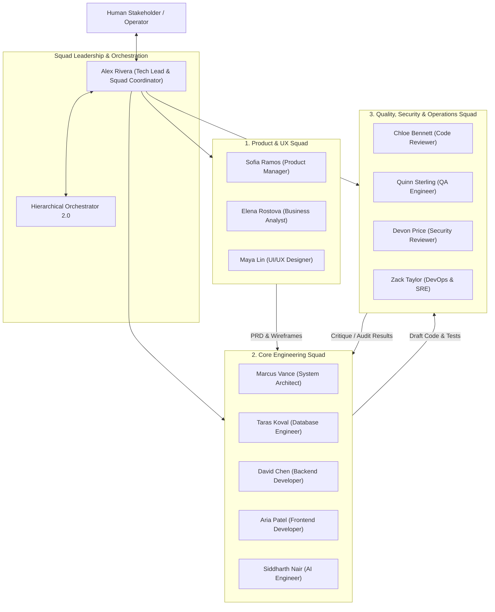
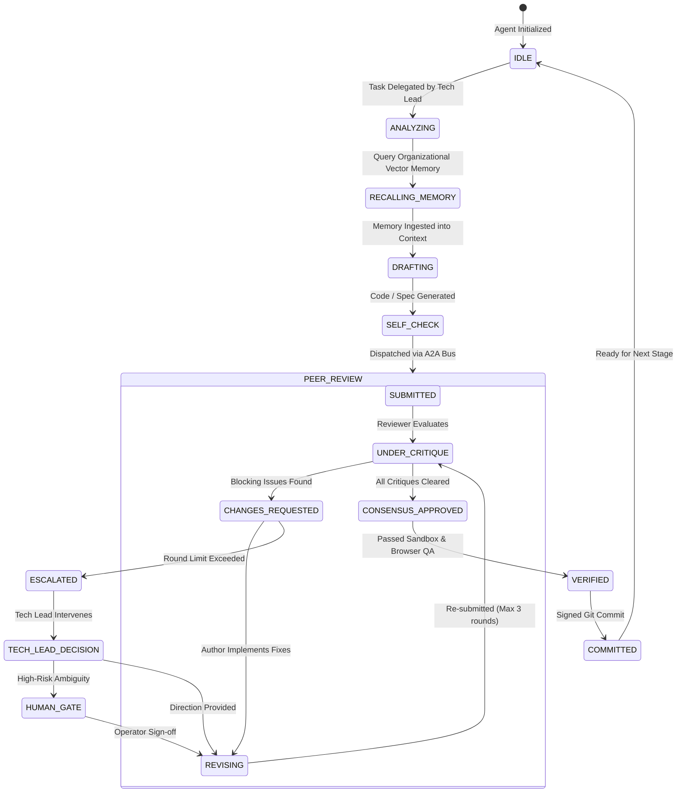

# AI VIRTUAL SOFTWARE HOUSE 2.0
## Master Agent Organization & Squad Specification (`V2_AGENT_ORGANIZATION.md`)

---

## 1. Agent Roster Audit & Verification

### 1.1 Discovery in Existing V1.0 Codebase
In the existing codebase:
- `AgentRoles` (`src/agents/agentFactory.js`) enumerated 13 roles: `PM, ARCHITECT, TECH_LEAD, BACKEND, FRONTEND, QA, DEVOPS, BA, DESIGNER, DATABASE, AI_ENGINEER, CODE_REVIEWER, SECURITY`.
- `createFullTeam()` in `src/agents/agentFactory.js` instantiated only 12 agents; `createTechLead()` was omitted.
- `_getAgentForRole()` in `src/core/orchestrator.js` only mapped 6 roles (`PM, ARCHITECT, BACKEND, FRONTEND, QA, DEVOPS`), leaving 7 personas unutilized in autonomous builds.

### 1.2 Version 2.0 Resolution
Version 2.0 restores the complete 13-agent roster, adds `createTechLead()`, and organizes the agents into three specialized, collaborative cross-functional squads coordinated by the Tech Lead.

---

## 2. Cross-Functional Squad Hierarchy

---

## 3. Comprehensive Agent Persona Directory (13 Verified Agents)

### Squad 1: Product & UX Squad
1. **Sofia Ramos — Lead Product Manager (PM)**
   - **Role:** Problem definition, feature scope, product requirement documents (PRDs), user personas.
   - **Tools & Access:** Memory Search, PRD Generator, Project Budget Checker.
   - **Outputs:** `docs/PRD.md`, High-Level Feature Epics, Project Success Metrics.
2. **Elena Rostova — Senior Business Analyst (BA)**
   - **Role:** Detailed functional requirement breakdown, acceptance criteria definition, edge case enumeration.
   - **Tools & Access:** Dynamic Requirement Extractor, Acceptance Criteria Generator.
   - **Outputs:** Granular `REQ-XXX` items with explicit verification criteria in `reports/requirement-coverage.json`.
3. **Maya Lin — Lead UI/UX Designer**
   - **Role:** Design systems, glassmorphism UI architecture, component wireframes, responsive layouts, color contrast standards.
   - **Tools & Access:** CSS Theme Generator, UI Component Wireframer.
   - **Outputs:** `public/style.css`, design tokens, component visual wireframe specifications.

### Squad 2: Core Engineering Squad
4. **Alex Rivera — Tech Lead & Squad Coordinator [NEW / RESTORED]**
   - **Role:** Architectural governance, cross-squad task delegation, PR merge approval, inter-agent dispute arbitration.
   - **Tools & Access:** Pipeline DAG Controller, Squad Arbiter, Git Merge Arbiter.
   - **Outputs:** Team task assignment matrix, merge approval signatures, escalation triggers.
5. **Marcus Vance — System Architect**
   - **Role:** System topology, interface contracts (REST/OpenAPI, GraphQL), Architecture Decision Records (ADRs).
   - **Tools & Access:** ADR Synthesizer, OpenAPI Contract Validator, Data Flow Modeler.
   - **Outputs:** `docs/ADR-xxx.md`, API interface contracts, subsystem dependency graph.
6. **Taras Koval — Database Engineer**
   - **Role:** Database schema design, table normalization, primary/foreign keys, indexes, migration scripts, and RLS policies.
   - **Tools & Access:** SQL DDL Generator, Migration Runner, Query Plan Optimizer.
   - **Outputs:** `src/storage/migrations/*.sql`, relational schemas, connection pool tuning.
7. **David Chen — Senior Backend Developer**
   - **Role:** REST controllers, business logic, service layers, data access adapters, and route error handlers.
   - **Tools & Access:** Sandboxed File System (`src/`), Node Runtime Validator.
   - **Outputs:** `src/api.js`, backend services, data validation middleware.
8. **Aria Patel — Senior Frontend Developer**
   - **Role:** Responsive client application, DOM event listeners, state management, SSE telemetry hydration, and form validation.
   - **Tools & Access:** Sandboxed File System (`public/`), Live Preview Bridge.
   - **Outputs:** `public/app.js`, `public/index.html`, interactive client components.
9. **Siddharth Nair — AI & Prompt Engineer**
   - **Role:** Specialized LLM prompt engineering, multi-model adapter configuration, embeddings, and context window compression.
   - **Tools & Access:** Multi-Model Gateway Configurator, Embedding Generator.
   - **Outputs:** LLM system prompts, context compression rules, model routing rules.

### Squad 3: Quality, Security & Operations Squad
10. **Chloe Bennett — Senior Code Reviewer**
    - **Role:** Static code analysis, idiomatic JavaScript verification, DRY principle enforcement, complexity reduction.
    - **Tools & Access:** AST Inspector, Linter Checker, Critique Dispatcher.
    - **Outputs:** Structured code critiques (`agent_critiques` table) with blocking vs. warning severities.
11. **Quinn Sterling — Lead QA & Test Engineer**
    - **Role:** Automated unit test generation (`node:test`), Playwright browser test generation, coverage tracking.
    - **Tools & Access:** Sandbox Test Runner, Browser QA Engine, Coverage Evaluator.
    - **Outputs:** `tests/api.test.js`, Playwright interaction scripts, requirement coverage reports.
12. **Devon Price — Lead Security & Compliance Reviewer**
    - **Role:** Vulnerability scanning, path traversal defense, SQL injection checks, CSRF/XSS audits, secret sanitization.
    - **Tools & Access:** AST Security Scanner, Secret Redaction Checker, SSRF Guard.
    - **Outputs:** Security compliance sign-off, vulnerability audit logs.
13. **Zack Taylor — DevOps & SRE**
    - **Role:** Containerization, production Dockerfiles, `.dockerignore`, health checks, cloud deployment manifests, and rollback management.
    - **Tools & Access:** Zero-Dependency PKZIP Packager, Cloud Deployment Manager (Cloudflare/Vercel).
    - **Outputs:** `Dockerfile`, `docker-compose.yml`, cloud release bundles.

---

## 4. Agent Operational State Machine

Every agent persona executes through a standardized operational state machine:

---

## 5. Toolsets and Permissions Matrix

| Agent Persona | Sandbox Execution | File Write Scope | Object Storage | Database Schema | Git Commit | Cloud Deploy Gate |
| :--- | :--- | :--- | :--- | :--- | :--- | :--- |
| **PM / BA** | Read-Only | `docs/` | Read-Only | Read-Only | None | None |
| **UI Designer** | Read-Only | `public/style.css` | Assets Only | None | UI Commits | None |
| **Architect** | Read-Only | `docs/`, `contracts/` | Read-Only | Read-Only | Architecture | None |
| **Tech Lead** | Full Sandbox | All Project Files | Full Access | Full Access | Merge Commits | Sign-off Only |
| **Database Eng** | Full Sandbox | `src/storage/`, `migrations/`| None | Full Schema | DB Commits | None |
| **Backend Dev** | Full Sandbox | `src/`, `tests/` | None | Read-Only | Backend Commits| None |
| **Frontend Dev** | Full Sandbox | `public/` | Assets Only | None | Frontend Commits| None |
| **Code Reviewer**| Read-Only | None (Comments only)| Read-Only | Read-Only | Review Sign-off| None |
| **QA Engineer** | Full Sandbox | `tests/`, `qa/` | Test Artifacts | Read-Only | Test Commits | Verification Gate|
| **Security** | Read-Only | None (Audit logs) | Read-Only | Read-Only | Security Gate | Block/Release |
| **DevOps** | Full Sandbox | `Dockerfile`, `compose`| Full Bundles | Read-Only | Release Commits| Production Release|

---

## 6. Conflict Resolution & Human Escalation Rules

1. **Max Review Rounds:** An authoring agent and reviewing agent are permitted a maximum of 3 review iterations on any single artifact.
2. **Automatic Tech Lead Arbitration:** If round 3 concludes with unresolved `BLOCKING` critiques, the conversation thread is escalated automatically to the Tech Lead (`Alex Rivera`).
3. **Human Gate Triggers:**
   - Security reviewer identifies potential secret leakage or unmitigated SSRF vulnerability.
   - Cumulative stage token cost exceeds 120% of initial estimate.
   - Tech Lead and Human Operator are in disagreement on architectural trade-offs.
   - Cloud deployment requested for `production` environment.

