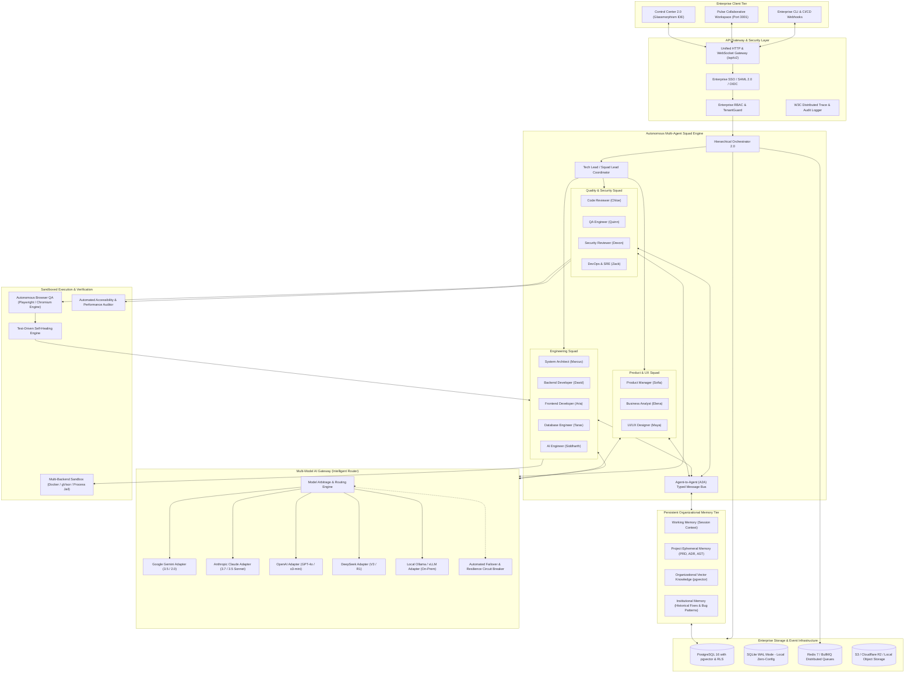
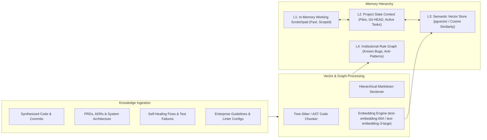

# AI VIRTUAL SOFTWARE HOUSE 2.0
## Master Enterprise Architecture Specification (`V2_ARCHITECTURE.md`)

---

## 1. Executive Summary & Vision

The **AI Virtual Software House 2.0** represents the evolution of the platform from a single-model, stage-bound prototype generator into an **enterprise-grade autonomous software engineering organization**. Version 2.0 establishes a multi-tenant, multi-model AI infrastructure capable of receiving complex enterprise software specifications, autonomously coordinating cross-functional AI squads, executing verified browser and unit testing, maintaining persistent institutional memory, and releasing production-grade applications with zero regression.

---

## 2. Existing Architecture vs. Version 2.0 Target Matrix

| Architectural Vector | Existing V1.0 Platform | Enterprise V2.0 Target | Gap Analysis & Upgrade Path |
| :--- | :--- | :--- | :--- |
| **Model Gateway** | Hardcoded Google Gemini REST (`src/llm/geminiClient.js`, 14 RPM limiter). | Unified Pluggable Multi-Model AI Gateway (Gemini, Anthropic Claude, OpenAI, DeepSeek, Local Ollama). | Multi-provider abstraction with automated cost/latency routing, token streaming, and automatic fallback cascades. |
| **Agent Roster & Usage** | 13 personas in enum; 12 created; only 6 wired into DAG (`src/core/orchestrator.js`). `createTechLead` missing. | 13 fully instantiated, autonomous agents with peer negotiation, PR review cycles, and dynamic squad assembly. | Implement `createTechLead()`, wire all 13 personas into hierarchical review loops and collaborative sub-teams. |
| **Organizational Memory**| Ephemeral in-memory payloads; no cross-session or cross-project memory. | Persistent Multi-Tier Memory: Working Memory, Project Memory, and Vector Organizational Knowledge (`pgvector`). | Embeddings generation, semantic ADR/PRD search, institutional bug pattern retrieval, and continuous learning. |
| **Agent Communication** | Monolithic sequential DAG handoff (`STAGE_INTAKE` -> `STAGE_ARCH` -> `STAGE_DEV`). | Structured Inter-Agent Protocol (A2A) with RFC-style proposals, critique rounds, and consensus arbitration. | Message schema with typed intents (`PROPOSE`, `CRITIQUE`, `REVISE`, `APPROVE`, `ESCALATE`). |
| **Testing & QA** | Sandboxed `node:test` execution + lightweight HTTP fetch checks (`realBrowserTester.js`). | Full-stack Browser QA with containerized headless Playwright/Chromium, visual regression, and Axe accessibility audits. | Headless browser execution container, DOM interaction trace recorder, screenshot diffing, and HAR network inspection. |
| **Sandboxing & Compute**| Docker with host `PROCESS_JAIL` fallback (`src/sandbox/sandboxExecutor.js`). | Tiered Isolation: Rootless Docker with gVisor (`runsc`) / MicroVM isolation for untrusted tenant code execution. | gVisor runtime integration, per-tenant network namespaces, and egress firewalls for enterprise compliance. |
| **Persistence & Multi-Tenancy** | SQLite WAL (local) + PostgreSQL with 8 migrations and RLS (`src/storage/`). | PostgreSQL 16 with pgvector, hierarchical enterprise organization trees (Orgs -> Workspaces -> Projects), and SSO. | Migration 009 & 010 adding vector embeddings, agent threads, model routing configs, and audit hash-chaining. |
| **API & Telemetry** | 45 REST endpoints + SSE stream on WHATWG URL parser (`src/server/server.js`). | Versioned API Gateway (`/api/v2/*`) with bidirectional WebSockets for low-latency agent streaming + SSE fallback. | WebSocket server integration, typed JSON-RPC/OpenAPI v3 contracts, and granular OAuth2/OIDC token scoping. |
| **Frontend Experience** | Vanilla JS Single Page Application (`public/app.js`, 3,488 lines). | Glassmorphism 2.0 SPA with Live Agent Multi-Stream, Visual DAG Graph Editor, Interactive Terminal, and Diff Viewer. | Split-pane IDE layout, interactive Monaco/CodeMirror diff viewer, real-time agent thought graph visualization. |

---

## 3. High-Level Enterprise Architecture Diagram



---

## 4. Multi-Model AI Gateway Specification

### 4.1 Routing Logic & Model Arbitrage
The Multi-Model Gateway dynamically inspects incoming task complexity, token length, domain, and tenant configuration to select the optimal model provider:

```text
Task Domain & Requirement                Target Model                     Fallback Model
──────────────────────────────────────────────────────────────────────────────────────────
System Architecture / ADRs / Schema      Claude 3.7 Sonnet / o3-mini      Gemini 1.5 Pro
Granular Backend / Frontend Code Gen     Claude 3.5 Sonnet / DeepSeek V3  Gemini 3.5 Flash
Fast Boilerplate / File Scaffolding      Gemini 3.5 Flash-Lite            DeepSeek V3
Security Review & Static Analysis        Claude 3.5 Sonnet                GPT-4o
Complex Self-Healing Diagnosis           o3-mini / Claude 3.7 Sonnet      Gemini 2.0 Flash
Local / Air-Gapped Enterprise Tenant     Ollama (Qwen 2.5 Coder 32B)      vLLM (DeepSeek R1 Distill)
```

### 4.2 Circuit Breaker & Failover Cascade
- Every provider adheres to standard circuit breaker states: `CLOSED` (Normal), `OPEN` (Tripped on 3 consecutive 429/500 errors), `HALF-OPEN` (Probing after 30s backoff).
- Failover is completely transparent to the caller: if Primary model fails or rate-limits, the gateway switches to Secondary within 500ms, preserving request payload and context framing.

---

## 5. Persistent Organizational Memory Architecture



---

## 6. Advanced Agent-to-Agent (A2A) Communication Protocol

### 6.1 Message Envelope Specification
```json
{
  "messageId": "msg_01h8a9bcdef01234",
  "threadId": "thrd_proj-123_backend-arch",
  "projectId": "proj-123",
  "tenantId": "tenant-enterprise-alpha",
  "fromAgent": "ARCHITECT",
  "toAgent": "BACKEND",
  "intent": "PROPOSE_CONTRACT",
  "status": "AWAITING_REVIEW",
  "payload": {
    "artifactType": "OPENAPI_SPEC",
    "targetFiles": ["src/api/routes.js", "src/models/schema.js"],
    "content": "...",
    "acceptanceCriteria": ["REQ-001", "REQ-002"]
  },
  "contextReferences": [
    { "type": "ADR", "id": "ADR-001" },
    { "type": "MEMORY_SNIPPET", "vectorId": "vec_8941" }
  ],
  "timestamp": "2026-11-03T08:15:00.000Z"
}
```

### 6.2 Collaborative Review State Machine
1. **Proposal (`PROPOSE`)**: Agent submits draft artifact to peer.
2. **Review & Critique (`CRITIQUE`)**: Reviewer identifies syntax bugs, missing acceptance criteria, or security risks.
3. **Revision (`REVISE`)**: Submitting agent addresses critiques with bounded revision count (max 3 rounds).
4. **Consensus Sign-Off (`APPROVE`)**: Reviewer signs off with cryptographic hash.
5. **Escalation (`ESCALATE`)**: If consensus cannot be reached, task is escalated to Tech Lead or human operator.

---

## 7. Autonomous Engineering & Browser QA Engine

- **Chromium / Playwright in Sandbox:** Executes containerized headless browser tests against live preview ports.
- **Visual Regression:** Captures DOM screenshots, computes pixel-diff ratios, and flags UI misalignments.
- **Accessibility & Security Checks:** Injects Axe-core for WCAG 2.1 AA compliance and inspects console warnings, unhandled promise rejections, and failed network assets (4xx/5xx).
- **Self-Healing Bridge:** Test assertion failures output precise line numbers, stack traces, and DOM dumps directly into QA Agent's diagnostic context for targeted re-synthesis.

---

## 8. Enterprise Infrastructure, Security & Compliance

1. **Authentication:** SAML 2.0 and OIDC integrations (Okta, Azure AD, Google Workspace) preserving existing Scrypt fallback.
2. **Untrusted Code Isolation:** Support for rootless Docker and gVisor (`runsc`) sandboxing, disabling all host networking and root capabilities.
3. **Audit Logging & SOC 2 Compliance:** Tamper-evident audit logs with cryptographic hash chaining (`prevLogHash` + `currentLogData` -> `SHA256`).
4. **Data Isolation:** Enforce PostgreSQL Row-Level Security (`current_setting('app.current_tenant_id')`) across all new tables.

