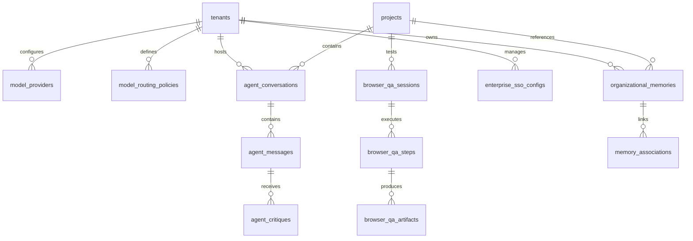

# AI VIRTUAL SOFTWARE HOUSE 2.0
## Master Database Architecture & Schema Specification (`V2_DATABASE_DESIGN.md`)

---

## 1. Database Architecture & Engine Standards

The V2.0 Database Tier builds directly upon the existing 8 migrations while introducing enterprise multi-model governance, organizational vector memory, agent-to-agent collaboration threads, and automated browser QA tracking.

- **Primary Production Engine:** PostgreSQL 16+ with `pgvector` extension enabled.
- **Embedded / Local Development Engine:** SQLite 3 (WAL mode) with an in-memory cosine-similarity fallback for vector queries to preserve zero-configuration local runs.
- **Multi-Tenancy Guardrail:** Every table is partitioned by `tenant_id` and protected by engine-level PostgreSQL Row-Level Security (RLS) policies checking `app.current_tenant_id`.

---

## 2. Entity-Relationship Model (V2.0 Extensions)



---

## 3. Comprehensive Table Specifications (V2.0)

### 3.1 Multi-Model AI Gateway Tables

#### `model_providers`
Configures active model providers per tenant or platform-wide.
```sql
CREATE TABLE IF NOT EXISTS model_providers (
  id VARCHAR(64) PRIMARY KEY,
  tenant_id VARCHAR(64) NOT NULL REFERENCES tenants(id) ON DELETE CASCADE,
  provider_type VARCHAR(50) NOT NULL, -- 'GEMINI', 'ANTHROPIC', 'OPENAI', 'DEEPSEEK', 'OLLAMA'
  display_name VARCHAR(100) NOT NULL,
  api_endpoint VARCHAR(255),
  encrypted_api_key TEXT,
  rate_limit_rpm INTEGER NOT NULL DEFAULT 60,
  rate_limit_tpm INTEGER NOT NULL DEFAULT 100000,
  cost_per_1k_input_tokens NUMERIC(10, 6) NOT NULL DEFAULT 0.001,
  cost_per_1k_output_tokens NUMERIC(10, 6) NOT NULL DEFAULT 0.002,
  is_active BOOLEAN NOT NULL DEFAULT TRUE,
  created_at TIMESTAMPTZ NOT NULL DEFAULT NOW(),
  updated_at TIMESTAMPTZ NOT NULL DEFAULT NOW()
);
CREATE INDEX IF NOT EXISTS idx_model_providers_tenant ON model_providers(tenant_id, is_active);
```

#### `model_routing_policies`
Defines automated arbitrage and fallback cascades based on task domain and complexity.
```sql
CREATE TABLE IF NOT EXISTS model_routing_policies (
  id VARCHAR(64) PRIMARY KEY,
  tenant_id VARCHAR(64) NOT NULL REFERENCES tenants(id) ON DELETE CASCADE,
  task_domain VARCHAR(64) NOT NULL, -- 'ARCHITECTURE', 'CODE_GEN', 'SECURITY', 'QA', 'TRIAGE'
  primary_provider_id VARCHAR(64) NOT NULL REFERENCES model_providers(id) ON DELETE CASCADE,
  primary_model_name VARCHAR(100) NOT NULL,
  fallback_provider_id VARCHAR(64) REFERENCES model_providers(id) ON DELETE SET NULL,
  fallback_model_name VARCHAR(100),
  max_output_tokens INTEGER NOT NULL DEFAULT 8192,
  temperature NUMERIC(3, 2) NOT NULL DEFAULT 0.70,
  priority_weight INTEGER NOT NULL DEFAULT 10,
  created_at TIMESTAMPTZ NOT NULL DEFAULT NOW(),
  updated_at TIMESTAMPTZ NOT NULL DEFAULT NOW(),
  CONSTRAINT uq_tenant_domain UNIQUE (tenant_id, task_domain)
);
CREATE INDEX IF NOT EXISTS idx_routing_policies_lookup ON model_routing_policies(tenant_id, task_domain);
```

---

### 3.2 Persistent Organizational Memory Tables

#### `organizational_memories`
Stores chunked architectural knowledge, past bug patterns, and code solutions with vector embeddings.
```sql
-- Enables pgvector extension if available
CREATE EXTENSION IF NOT EXISTS vector;

CREATE TABLE IF NOT EXISTS organizational_memories (
  id VARCHAR(64) PRIMARY KEY,
  tenant_id VARCHAR(64) NOT NULL REFERENCES tenants(id) ON DELETE CASCADE,
  project_id VARCHAR(64) REFERENCES projects(id) ON DELETE SET NULL,
  memory_type VARCHAR(50) NOT NULL, -- 'ADR', 'PRD', 'BUG_FIX', 'CODING_STANDARD', 'SECURITY_RULE'
  title VARCHAR(255) NOT NULL,
  content TEXT NOT NULL,
  metadata JSONB NOT NULL DEFAULT '{}'::jsonb,
  embedding vector(1536), -- Vector embeddings (OpenAI 1536 or Gemini 768 resized)
  source_file VARCHAR(255),
  confidence_score NUMERIC(4, 3) NOT NULL DEFAULT 1.000,
  access_count INTEGER NOT NULL DEFAULT 0,
  last_accessed_at TIMESTAMPTZ,
  created_at TIMESTAMPTZ NOT NULL DEFAULT NOW(),
  updated_at TIMESTAMPTZ NOT NULL DEFAULT NOW()
);

CREATE INDEX IF NOT EXISTS idx_org_memories_tenant ON organizational_memories(tenant_id, memory_type);
CREATE INDEX IF NOT EXISTS idx_org_memories_embedding ON organizational_memories USING ivfflat (embedding vector_cosine_ops) WITH (lists = 100);
```

#### `memory_associations`
Maps connections between code requirements, ADRs, and historical bug resolutions.
```sql
CREATE TABLE IF NOT EXISTS memory_associations (
  id VARCHAR(64) PRIMARY KEY,
  tenant_id VARCHAR(64) NOT NULL REFERENCES tenants(id) ON DELETE CASCADE,
  source_memory_id VARCHAR(64) NOT NULL REFERENCES organizational_memories(id) ON DELETE CASCADE,
  target_memory_id VARCHAR(64) NOT NULL REFERENCES organizational_memories(id) ON DELETE CASCADE,
  relationship_type VARCHAR(50) NOT NULL, -- 'SUPERSEDES', 'RESOLVES', 'REFERENCES', 'CONFLICTS_WITH'
  notes TEXT,
  created_at TIMESTAMPTZ NOT NULL DEFAULT NOW(),
  CONSTRAINT uq_memory_assoc UNIQUE (source_memory_id, target_memory_id, relationship_type)
);
```

---

### 3.3 Agent-to-Agent (A2A) Communication & Thread Tables

#### `agent_conversations`
Peer-to-peer and squad consultation threads between agents.
```sql
CREATE TABLE IF NOT EXISTS agent_conversations (
  id VARCHAR(64) PRIMARY KEY,
  tenant_id VARCHAR(64) NOT NULL REFERENCES tenants(id) ON DELETE CASCADE,
  project_id VARCHAR(64) NOT NULL REFERENCES projects(id) ON DELETE CASCADE,
  topic VARCHAR(255) NOT NULL,
  initiator_role VARCHAR(50) NOT NULL,
  target_role VARCHAR(50) NOT NULL,
  stage VARCHAR(50) NOT NULL,
  status VARCHAR(50) NOT NULL DEFAULT 'OPEN', -- 'OPEN', 'RESOLVED', 'ESCALATED_TO_HUMAN'
  created_at TIMESTAMPTZ NOT NULL DEFAULT NOW(),
  updated_at TIMESTAMPTZ NOT NULL DEFAULT NOW()
);
CREATE INDEX IF NOT EXISTS idx_agent_conv_proj ON agent_conversations(project_id, status);
```

#### `agent_messages`
Immutable typed messages passed across agent squads.
```sql
CREATE TABLE IF NOT EXISTS agent_messages (
  id VARCHAR(64) PRIMARY KEY,
  tenant_id VARCHAR(64) NOT NULL REFERENCES tenants(id) ON DELETE CASCADE,
  conversation_id VARCHAR(64) NOT NULL REFERENCES agent_conversations(id) ON DELETE CASCADE,
  from_role VARCHAR(50) NOT NULL,
  to_role VARCHAR(50) NOT NULL,
  intent VARCHAR(50) NOT NULL, -- 'PROPOSE', 'CRITIQUE', 'REVISE', 'APPROVE', 'ESCALATE'
  content TEXT NOT NULL,
  artifacts_attached JSONB NOT NULL DEFAULT '[]'::jsonb,
  sequence_number INTEGER NOT NULL,
  created_at TIMESTAMPTZ NOT NULL DEFAULT NOW()
);
CREATE INDEX IF NOT EXISTS idx_agent_msg_conv ON agent_messages(conversation_id, sequence_number ASC);
```

#### `agent_critiques`
Structured feedback provided during code review and security audits.
```sql
CREATE TABLE IF NOT EXISTS agent_critiques (
  id VARCHAR(64) PRIMARY KEY,
  tenant_id VARCHAR(64) NOT NULL REFERENCES tenants(id) ON DELETE CASCADE,
  message_id VARCHAR(64) NOT NULL REFERENCES agent_messages(id) ON DELETE CASCADE,
  reviewer_role VARCHAR(50) NOT NULL,
  file_path VARCHAR(255) NOT NULL,
  line_number INTEGER,
  severity VARCHAR(32) NOT NULL DEFAULT 'WARNING', -- 'BLOCKING', 'WARNING', 'INFO'
  issue_description TEXT NOT NULL,
  suggested_fix TEXT,
  is_resolved BOOLEAN NOT NULL DEFAULT FALSE,
  resolved_at TIMESTAMPTZ,
  created_at TIMESTAMPTZ NOT NULL DEFAULT NOW()
);
CREATE INDEX IF NOT EXISTS idx_agent_critiques_msg ON agent_critiques(message_id, is_resolved);
```

---

### 3.4 Autonomous Browser QA & Interaction Testing Tables

#### `browser_qa_sessions`
Tracks containerized Playwright browser evaluation runs against live preview endpoints.
```sql
CREATE TABLE IF NOT EXISTS browser_qa_sessions (
  id VARCHAR(64) PRIMARY KEY,
  tenant_id VARCHAR(64) NOT NULL REFERENCES tenants(id) ON DELETE CASCADE,
  project_id VARCHAR(64) NOT NULL REFERENCES projects(id) ON DELETE CASCADE,
  target_url VARCHAR(512) NOT NULL,
  browser_type VARCHAR(32) NOT NULL DEFAULT 'CHROMIUM', -- 'CHROMIUM', 'FIREFOX', 'WEBKIT'
  viewport_width INTEGER NOT NULL DEFAULT 1280,
  viewport_height INTEGER NOT NULL DEFAULT 800,
  status VARCHAR(32) NOT NULL DEFAULT 'RUNNING', -- 'RUNNING', 'PASSED', 'FAILED', 'TIMED_OUT'
  total_assertions INTEGER NOT NULL DEFAULT 0,
  passed_assertions INTEGER NOT NULL DEFAULT 0,
  failed_assertions INTEGER NOT NULL DEFAULT 0,
  axe_violations_count INTEGER NOT NULL DEFAULT 0,
  duration_ms INTEGER NOT NULL DEFAULT 0,
  error_summary TEXT,
  created_at TIMESTAMPTZ NOT NULL DEFAULT NOW(),
  completed_at TIMESTAMPTZ
);
CREATE INDEX IF NOT EXISTS idx_browser_qa_proj ON browser_qa_sessions(project_id, created_at DESC);
```

#### `browser_qa_steps`
Granular browser action traces (navigations, clicks, typing, visual checks).
```sql
CREATE TABLE IF NOT EXISTS browser_qa_steps (
  id VARCHAR(64) PRIMARY KEY,
  session_id VARCHAR(64) NOT NULL REFERENCES browser_qa_sessions(id) ON DELETE CASCADE,
  step_number INTEGER NOT NULL,
  action_type VARCHAR(64) NOT NULL, -- 'GOTO', 'CLICK', 'FILL', 'ASSERT_VISIBLE', 'SCREENSHOT', 'AXE_CHECK'
  selector VARCHAR(255),
  input_value TEXT,
  status VARCHAR(32) NOT NULL DEFAULT 'PASSED', -- 'PASSED', 'FAILED'
  error_message TEXT,
  duration_ms INTEGER NOT NULL DEFAULT 0,
  created_at TIMESTAMPTZ NOT NULL DEFAULT NOW()
);
CREATE INDEX IF NOT EXISTS idx_browser_qa_steps_session ON browser_qa_steps(session_id, step_number ASC);
```

#### `browser_qa_artifacts`
Visual screenshots, DOM dumps, console logs, and HAR traces captured during QA.
```sql
CREATE TABLE IF NOT EXISTS browser_qa_artifacts (
  id VARCHAR(64) PRIMARY KEY,
  step_id VARCHAR(64) NOT NULL REFERENCES browser_qa_steps(id) ON DELETE CASCADE,
  artifact_type VARCHAR(64) NOT NULL, -- 'SCREENSHOT_PNG', 'DOM_SNAPSHOT_HTML', 'CONSOLE_LOGS_JSON', 'NETWORK_HAR'
  storage_backend VARCHAR(32) NOT NULL DEFAULT 'LOCAL',
  storage_key VARCHAR(512) NOT NULL,
  file_size_bytes INTEGER NOT NULL DEFAULT 0,
  diff_percentage NUMERIC(5, 2), -- Computed pixel diff ratio against baseline
  created_at TIMESTAMPTZ NOT NULL DEFAULT NOW()
);
```

---

### 3.5 Enterprise Security & SOC 2 Audit Hash Chaining

#### `tamper_evident_audit_log`
Cryptographically hash-chained audit table guaranteeing non-repudiation for enterprise compliance.
```sql
CREATE TABLE IF NOT EXISTS tamper_evident_audit_log (
  id BIGSERIAL PRIMARY KEY,
  tenant_id VARCHAR(64) NOT NULL REFERENCES tenants(id) ON DELETE CASCADE,
  user_id VARCHAR(64),
  action VARCHAR(128) NOT NULL,
  resource_type VARCHAR(64) NOT NULL,
  resource_id VARCHAR(64),
  payload_summary TEXT,
  ip_address VARCHAR(45),
  previous_hash VARCHAR(64) NOT NULL, -- SHA-256 hash of previous row
  entry_hash VARCHAR(64) NOT NULL,    -- SHA-256 (id + tenant_id + action + previous_hash + created_at)
  created_at TIMESTAMPTZ NOT NULL DEFAULT NOW()
);
CREATE INDEX IF NOT EXISTS idx_tamper_audit_tenant ON tamper_evident_audit_log(tenant_id, id DESC);
```

---

## 4. PostgreSQL Row-Level Security (RLS) Policy Extensions

All V2.0 tables enforce tenant isolation identically to Migration 003:

```sql
ALTER TABLE model_providers ENABLE ROW LEVEL SECURITY;
ALTER TABLE model_routing_policies ENABLE ROW LEVEL SECURITY;
ALTER TABLE organizational_memories ENABLE ROW LEVEL SECURITY;
ALTER TABLE memory_associations ENABLE ROW LEVEL SECURITY;
ALTER TABLE agent_conversations ENABLE ROW LEVEL SECURITY;
ALTER TABLE agent_messages ENABLE ROW LEVEL SECURITY;
ALTER TABLE agent_critiques ENABLE ROW LEVEL SECURITY;
ALTER TABLE browser_qa_sessions ENABLE ROW LEVEL SECURITY;
ALTER TABLE tamper_evident_audit_log ENABLE ROW LEVEL SECURITY;

CREATE POLICY tenant_isolation_model_providers ON model_providers
  FOR ALL USING (tenant_id = NULLIF(current_setting('app.current_tenant_id', true), ''))
  WITH CHECK (tenant_id = NULLIF(current_setting('app.current_tenant_id', true), ''));

CREATE POLICY tenant_isolation_org_memories ON organizational_memories
  FOR ALL USING (tenant_id = NULLIF(current_setting('app.current_tenant_id', true), ''))
  WITH CHECK (tenant_id = NULLIF(current_setting('app.current_tenant_id', true), ''));

CREATE POLICY tenant_isolation_agent_conv ON agent_conversations
  FOR ALL USING (tenant_id = NULLIF(current_setting('app.current_tenant_id', true), ''))
  WITH CHECK (tenant_id = NULLIF(current_setting('app.current_tenant_id', true), ''));

CREATE POLICY tenant_isolation_browser_qa ON browser_qa_sessions
  FOR ALL USING (tenant_id = NULLIF(current_setting('app.current_tenant_id', true), ''))
  WITH CHECK (tenant_id = NULLIF(current_setting('app.current_tenant_id', true), ''));
```

---

## 5. Migration Execution Strategy & Phasing

1. **Migration 009 (`009_v2_enterprise_memory_and_gateway.sql`):**
   - Installs `pgvector` extension if supported.
   - Creates `model_providers`, `model_routing_policies`, `organizational_memories`, and `memory_associations`.
   - Seeds baseline model providers (Gemini, Claude, OpenAI) for `tenant-default`.
2. **Migration 010 (`010_v2_browser_qa_and_agent_threads.sql`):**
   - Creates `agent_conversations`, `agent_messages`, `agent_critiques`.
   - Creates `browser_qa_sessions`, `browser_qa_steps`, `browser_qa_artifacts`.
   - Creates `tamper_evident_audit_log` with genesis hash.
3. **SQLite Backward Compatibility Shim (`src/storage/db.js`):**
   - Local SQLite maintains equivalent tables with in-memory JSON fallback for vector embeddings, guaranteeing existing local tests run without external dependencies.

