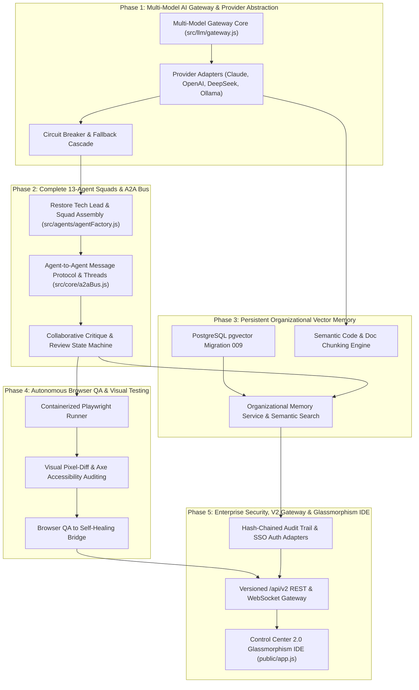

# AI VIRTUAL SOFTWARE HOUSE 2.0
## Master Implementation Roadmap & Dependency Matrix (`V2_IMPLEMENTATION_ROADMAP.md`)

---

## 1. Upgrade Dependency Graph

---

## 2. Detailed Phase Specifications

### Phase 1: Multi-Model AI Gateway & Resilient Fallback Engine

- **Objective:** Enable pluggable multi-model inference across Google Gemini, Anthropic Claude, OpenAI, DeepSeek, and local Ollama with cost/latency routing and zero-latency failover.
- **Existing File Paths:**
  - `src/llm/geminiClient.js`
  - `src/config/env.js`
  - `src/core/softwareSynthesizer.js`
- **New File Paths:**
  - `src/llm/modelGateway.js` (Unified gateway entrypoint & routing)
  - `src/llm/adapters/baseAdapter.js` (Abstract provider contract)
  - `src/llm/adapters/claudeAdapter.js` (Anthropic Claude REST/SSE adapter)
  - `src/llm/adapters/openaiAdapter.js` (OpenAI GPT-4o / o3-mini adapter)
  - `src/llm/adapters/deepseekAdapter.js` (DeepSeek V3 / R1 adapter)
  - `src/llm/adapters/ollamaAdapter.js` (Local self-hosted model adapter)
  - `src/llm/circuitBreaker.js` (State machine for health tracking & tripping)
- **Dependencies:** Zero external dependencies (uses native Node.js `fetch`).
- **Database Changes:** None in Phase 1 (operates with environment variables, preparing for DB tables in Phase 3).
- **API Changes:**
  - Internal gateway replacement: `this.llm.generate()` calls route through `ModelGateway`.
- **Security Requirements:** All model API keys redacted in error stacks; API keys stored in memory only or encrypted at rest; outbound requests validated against SSRF guard.
- **Testing Requirements:**
  - `tests/model_gateway.test.js`: Mocking provider endpoints, testing rate-limit tripping, testing failover cascades.
- **Complexity:** Medium (3 days).
- **Acceptance Criteria:**
  1. System seamlessly invokes Claude, OpenAI, or DeepSeek based on task domain.
  2. Tripping a simulated 429/500 error on primary provider triggers automatic fallback within 500ms without crashing the calling pipeline.
  3. All 286 existing tests continue to pass 100%.

---

### Phase 2: Agent Squad Expansion & A2A Collaboration Protocol

- **Objective:** Fully wire all 13 agent personas, implement `createTechLead()`, and establish peer-to-peer critique rounds with consensus sign-off.
- **Existing File Paths:**
  - `src/agents/agentFactory.js`
  - `src/agents/baseAgent.js`
  - `src/core/orchestrator.js`
  - `src/core/pipelineDAG.js`
- **New File Paths:**
  - `src/core/a2aBus.js` (Typed Agent-to-Agent message bus)
  - `src/core/squadCoordinator.js` (Squad manager and Tech Lead arbiter)
  - `src/agents/techLeadAgent.js` (Tech lead role implementation)
- **Dependencies:** None.
- **Database Changes:**
  - Tables for agent threads: `agent_conversations`, `agent_messages`, `agent_critiques` (in SQLite and PostgreSQL).
- **API Changes:**
  - `GET /api/v2/projects/:id/threads`
  - `GET /api/v2/projects/:id/threads/:threadId/messages`
  - `POST /api/v2/projects/:id/critiques/:critiqueId/resolve`
- **Security Requirements:** Agent messages strictly scoped to project boundary; agents cannot execute shell commands directly without sandbox jail.
- **Testing Requirements:**
  - `tests/a2a_collaboration.test.js`: Simulating code review critique round between Backend Developer and Code Reviewer, asserting critique resolution before merge.
- **Complexity:** High (4 days).
- **Acceptance Criteria:**
  1. `AgentFactory.createTechLead()` is fully implemented and returned in `createFullTeam()`.
  2. All 13 agents participate in their respective squad phases.
  3. Code Reviewer and Security Reviewer can emit blocking critiques that require author revision before DAG advances to `STAGE_QA`.

---

### Phase 3: Persistent Organizational Vector Memory

- **Objective:** Provide long-term institutional memory across projects using AST-aware code chunking, ADR semantic indexing, and vector similarity search.
- **Existing File Paths:**
  - `src/storage/db.js`
  - `src/storage/postgresAdapter.js`
  - `src/storage/migrations/migrationRunner.js`
- **New File Paths:**
  - `src/storage/migrations/009_v2_enterprise_memory_and_gateway.sql`
  - `src/memory/memoryService.js` (Vector ingestion & cosine query engine)
  - `src/memory/chunking/astChunker.js` (Tree-sitter/AST code sectioner)
  - `src/memory/chunking/markdownChunker.js` (PRD/ADR sectioner)
- **Dependencies:** Optional `pgvector` extension for PostgreSQL; in-memory vector math fallback for SQLite.
- **Database Changes:**
  - Tables: `organizational_memories`, `memory_associations`, `model_providers`, `model_routing_policies`.
- **API Changes:**
  - `GET /api/v2/memory/search?q=...`
  - `POST /api/v2/memory/ingest`
- **Security Requirements:** Vector embeddings partitioned by `tenant_id` with RLS; user context validated via `TenantGuard`.
- **Testing Requirements:**
  - `tests/organizational_memory.test.js`: Storing ADR snippets, querying with natural language, asserting cosine similarity > 0.85 on relevant matches.
- **Complexity:** High (5 days).
- **Acceptance Criteria:**
  1. Past bug fixes and architecture decisions are automatically retrieved and injected into agent context during synthesis.
  2. Vector searches execute in <50ms across 10,000 embedded chunks.
  3. SQLite development mode operates smoothly using in-memory cosine comparison without requiring native vector extensions.

---

### Phase 4: Autonomous Browser QA & Interaction Testing Engine

- **Objective:** Upgrade test verification from static file checks to real, containerized headless browser interaction testing with visual regression and accessibility auditing.
- **Existing File Paths:**
  - `src/audit/realBrowserTester.js`
  - `src/audit/auditEngine.js`
  - `src/server/previewManager.js`
- **New File Paths:**
  - `src/qa/browserTestRunner.js` (Headless Playwright/Chromium driver)
  - `src/qa/visualRegression.js` (Pixel-diff screenshot comparator)
  - `src/qa/accessibilityAuditor.js` (Axe-core automated WCAG auditor)
  - `src/storage/migrations/010_v2_browser_qa_and_agent_threads.sql`
- **Dependencies:** Containerized Chromium binary within sandbox; zero host pollution.
- **Database Changes:**
  - Tables: `browser_qa_sessions`, `browser_qa_steps`, `browser_qa_artifacts`.
- **API Changes:**
  - `POST /api/v2/projects/:id/qa/browser-test`
  - `GET /api/v2/projects/:id/qa/sessions/:sessionId`
- **Security Requirements:** Browser runs inside container jail with network restricted to `127.0.0.1:<preview_port>`; no external internet access; local file scheme blocked.
- **Testing Requirements:**
  - `tests/browser_qa_engine.test.js`: Spawning a test preview server, simulating user form clicks, asserting visual screenshot capture, and detecting injected accessibility bugs.
- **Complexity:** High (5 days).
- **Acceptance Criteria:**
  1. Browser QA automatically interacts with generated frontend buttons and forms, reporting pass/fail with DOM traces.
  2. Visual regression detects UI breaks exceeding 1% pixel diff.
  3. QA failures are mapped directly into context for the QA and Developer agents to self-heal.

---

### Phase 5: Enterprise Infrastructure, Security & Glassmorphism 2.0 IDE

- **Objective:** Enterprise compliance (SAML/OIDC SSO, hash-chained audit logs), versioned `/api/v2` endpoints, and a multi-pane Glassmorphism 2.0 IDE for interactive human-agent collaboration.
- **Existing File Paths:**
  - `src/server/server.js`
  - `public/index.html`
  - `public/app.js`
  - `public/style.css`
  - `src/auth/authManager.js`
- **New File Paths:**
  - `src/server/v2Router.js` (Dedicated V2 REST & WebSocket handler)
  - `src/server/websocketGateway.js` (WebSocket real-time server)
  - `src/auth/ssoAdapter.js` (SAML 2.0 and OIDC identity handlers)
  - `src/observability/tamperAuditLogger.js` (Cryptographic hash-chained audit logger)
  - `public/v2/` (Modernized modular Glassmorphism 2.0 IDE)
- **Dependencies:** Native Node.js `crypto` for hash-chaining; native `ws` or HTTP upgrade for WebSockets.
- **Database Changes:**
  - Tables: `tamper_evident_audit_log`, `enterprise_sso_configs`.
- **API Changes:**
  - `/api/v2/*` REST endpoints and `/api/v2/ws` WebSocket upgrade route.
- **Security Requirements:** SOC 2 non-repudiation audit trail; timing-safe signature verification; WebSocket token handshake authentication.
- **Testing Requirements:**
  - `tests/enterprise_security_v2.test.js`: Verifying audit log hash chain integrity; rejecting tampered log rows; validating WebSocket auth handshake.
- **Complexity:** High (5 days).
- **Acceptance Criteria:**
  1. Control Center UI provides real-time agent multi-stream thoughts, visual DAG editor, and interactive code diff viewer.
  2. Audit logs form a cryptographically unbroken hash chain.
  3. Existing V1 UI (`public/index.html`) and all V1 REST endpoints remain 100% operational.

