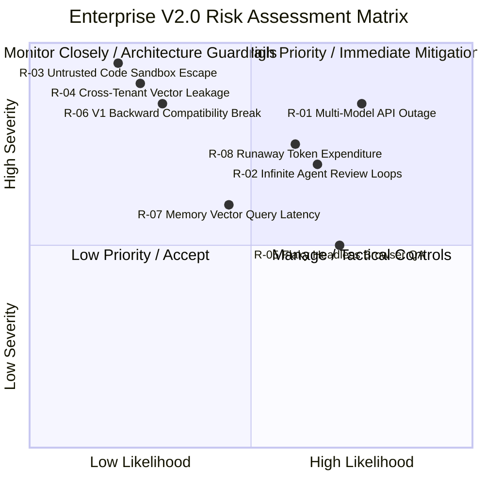

# AI VIRTUAL SOFTWARE HOUSE 2.0
## Master Enterprise Risk Register & Mitigation Strategy (`V2_RISK_REGISTER.md`)

---

## 1. Risk Assessment Framework

This document tracks all identified technical, architectural, security, and operational risks associated with upgrading to **AI Virtual Software House 2.0**. Each risk is evaluated by Likelihood (1–5) and Severity (1–5), yielding a Composite Risk Score (1–25) alongside dedicated architectural mitigations and rollback procedures.

---

## 2. Risk Matrix

---

## 3. Comprehensive Risk Directory

### Category 1: AI Model Gateway & Cost Risks

#### `RISK-01`: Primary Model Outage or Aggressive Rate Limiting (429)
- **Likelihood:** High (4) | **Severity:** High (4) | **Risk Score:** 16
- **Impact:** Autonomous software synthesis stalls, causing job timeouts and broken pipeline builds.
- **Mitigation:**
  - Automated circuit breaker (`CLOSED` -> `OPEN` on 3 failures within 60s).
  - Multi-provider fallback cascade (Primary Claude/Gemini -> Secondary OpenAI/DeepSeek).
  - Sliding-window rate limiters with token bucket queues.
- **Rollback / Fallback:** Automatic zero-downtime routing to secondary model within 500ms.

#### `RISK-02`: Runaway Token Expenditure Across Multi-Agent Discussions
- **Likelihood:** Medium (3) | **Severity:** High (4) | **Risk Score:** 12
- **Impact:** Excessive API bills caused by unbounded multi-agent negotiation rounds.
- **Mitigation:**
  - Hard token caps per project enforced by `BudgetManager`.
  - Strict ceiling on agent debate rounds (max 3 critique iterations).
  - Summarization and context window compression before passing history to subsequent stages.
- **Rollback / Fallback:** Immediate hard-stop (`BudgetExceededError`) triggering human approval request before another token can be spent.

---

### Category 2: Multi-Agent Coordination & Governance Risks

#### `RISK-03`: Infinite Agent Review Loops & Deadlocks
- **Likelihood:** Medium (3) | **Severity:** High (4) | **Risk Score:** 12
- **Impact:** Backend Developer and Code Reviewer enter endless cycles of critique and revision, blocking the DAG pipeline.
- **Mitigation:**
  - Maximum iteration counter: After 3 failed critique rounds, the thread is locked.
  - Automatic escalation to Tech Lead (`Alex Rivera`) for binding arbitration.
  - Tech Lead can force-merge, request human intervention, or redefine acceptance criteria.
- **Rollback / Fallback:** Pipeline state defaults to `PAUSED` and alerts the operator dashboard.

#### `RISK-04`: Agent Hallucination Leading to Secret Exposure in Code
- **Likelihood:** Medium (3) | **Severity:** Critical (5) | **Risk Score:** 15
- **Impact:** An agent accidentally hardcodes an API key or database password into generated frontend files (`public/app.js`).
- **Mitigation:**
  - AST-level secret scanner executed by `SecurityReviewer` before files are written to workspace.
  - Regex pattern matching against known key formats (AWS, Stripe, Gemini, JWT secrets).
  - `SecretManager` strips all parent process environment variables from container environments.
- **Rollback / Fallback:** Workspace file creation is aborted; security violation is logged to `auth_audit_logs`.

---

### Category 3: Security & Multi-Tenancy Isolation Risks

#### `RISK-05`: Cross-Tenant Vector Memory Data Leakage
- **Likelihood:** Low (2) | **Severity:** Critical (5) | **Risk Score:** 10
- **Impact:** A prompt query from Tenant B retrieves proprietary code snippets or ADRs belonging to Tenant A via vector search.
- **Mitigation:**
  - Engine-level PostgreSQL Row-Level Security (`RLS`) enabled on `organizational_memories`.
  - Every vector query mandates `tenant_id = current_setting('app.current_tenant_id')`.
  - Application-level `TenantGuard.assertTenantAccess()` validation before query execution.
- **Rollback / Fallback:** If RLS session variable is missing or empty, database returns 0 rows.

#### `RISK-06`: Untrusted Code Execution Jail Escape
- **Likelihood:** Low (1) | **Severity:** Critical (5) | **Risk Score:** 5
- **Impact:** Malicious generated code attempts to escape project container, mount host directories, or access metadata endpoints.
- **Mitigation:**
  - Rootless Docker with read-only root filesystems, drop all Linux capabilities (`--cap-drop=ALL`).
  - Strict forbidden path patterns blocking `/var/run/docker.sock`, `/etc`, `~/.ssh`.
  - Kernel-level gVisor (`runsc`) sandbox runtime evaluation for untrusted workloads.
  - `SSRFGuard` blocking internal private IP ranges (`10.0.0.0/8`, `169.254.169.254`).
- **Rollback / Fallback:** Process is killed immediately if execution exceeds 15,000ms or attempts forbidden syscalls.

---

### Category 4: Testing & Browser QA Risks

#### `RISK-07`: Flaky Headless Browser Interactions in Container
- **Likelihood:** High (4) | **Severity:** Medium (3) | **Risk Score:** 12
- **Impact:** Playwright browser tests fail intermittently due to rendering delays, false-positive network timing, or ephemeral port collisions.
- **Mitigation:**
  - Explicit port reservation locking via `PreviewManager.allocateFreePort()`.
  - Deterministic action retry policies (up to 3 retries per failed interaction step).
  - Explicit element visibility waiting (`waitForSelector`) rather than arbitrary timeouts.
- **Rollback / Fallback:** Mark browser run as `UNVERIFIED_TRANSIENT` and fall back to sandboxed unit test suite (`node:test`).

#### `RISK-08`: High Memory Usage by Headless Chromium Instances
- **Likelihood:** High (4) | **Severity:** Medium (3) | **Risk Score:** 12
- **Impact:** Zombie Chromium processes exhaust server memory, degrading platform performance.
- **Mitigation:**
  - Strict container lifecycle teardown in `finally` blocks (`browser.close()`).
  - Worker process pool with max 2 concurrent active browser sessions.
  - Automated idle session reaper terminating any preview server inactive for >10 minutes.
- **Rollback / Fallback:** OS-level container timeout kills container after 30 seconds.

---

### Category 5: Backward Compatibility & Operational Risks

#### `RISK-09`: Regression in Existing 286 Tests
- **Likelihood:** Low (2) | **Severity:** Critical (5) | **Risk Score:** 10
- **Impact:** Implementing V2.0 modules breaks existing V1.0 REST routes, SQLite storage, or test assertions.
- **Mitigation:**
  - Strict preservation of all existing file APIs and method signatures.
  - Versioned API gateway: all new capabilities live strictly under `/api/v2/*`.
  - Existing `src/storage/db.js` retains 100% synchronous SQLite WAL methods while adding V2 extensions.
  - Automated CI gate: No PR or upgrade merges unless `./bin/node --test tests/*.test.js apps/collaborative-workspace/tests/*.test.js` reports 286/286 passing.
- **Rollback / Fallback:** Git revert to verified commit hash `100% PASSING (286 tests)`.

---

## 4. Blast-Radius Containment & Safety Protocols

1. **Feature Flagging:** Every V2.0 module is protected by feature flags in `.env`:
   - `ENABLE_V2_MULTI_MODEL_GATEWAY=false` (Defaults to reliable Gemini client)
   - `ENABLE_V2_VECTOR_MEMORY=false` (Defaults to in-memory project context)
   - `ENABLE_V2_BROWSER_QA=false` (Defaults to existing `realBrowserTester.js`)
   - `ENABLE_V2_A2A_SQUADS=false` (Defaults to existing 6-stage DAG)
2. **Zero-Downtime Rollback:** If any V2 flag causes instability, toggling the flag to `false` instantly reverts execution to the verified V1.0 pipeline without database downtime or code rollback.
3. **Audit Trail Immutability:** Any security failure or gate rejection generates an immutable row in `tamper_evident_audit_log` with previous hash chaining.

