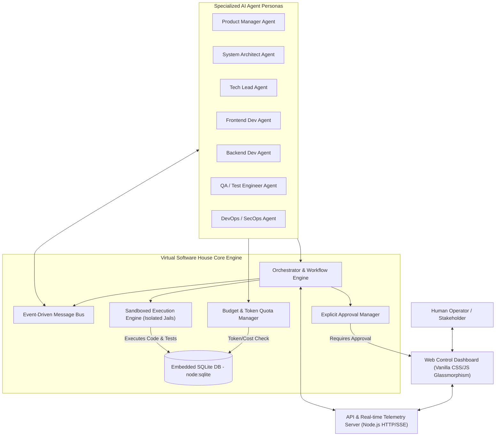
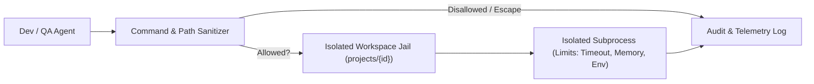

# AI Virtual Software House - System Architecture

## 1. Architectural Overview

The **AI Virtual Software House** is an enterprise-grade autonomous software development system designed with rigorous safety boundaries, strict financial quotas, and human-in-the-loop checkpoints.

---

## 2. Core Architectural Components

### 2.1 Multi-Agent Organization
The virtual company operates according to a structured software engineering hierarchy:
1. **Product Manager (PM)**:
   - Converts user requirements into structured epics, user stories, and acceptance criteria.
   - Rejects unfeasible or ambiguous requests.
2. **System Architect**:
   - Designs system topology, data structures, and interface contracts (REST/OpenAPI, GraphQL, DB schemas).
   - Produces Architecture Decision Records (ADRs).
3. **Tech Lead**:
   - Coordinates task assignment, reviews PRs, and enforces code standards.
4. **Backend Developer**:
   - Implements server-side logic, API endpoints, database access layers, and unit tests.
5. **Frontend Developer**:
   - Implements modern, responsive web interfaces, state management, and visual components.
6. **QA / Test Engineer**:
   - Generates automated unit and integration tests, executes tests inside the sandbox, and verifies pass criteria.
7. **DevOps & SecOps Engineer**:
   - Validates environment hygiene, inspects dependencies, checks security policies, and prepares deployment packages (holding at the approval gate).

---

### 2.2 Security & Sandbox Architecture

- **Path Isolation**: All file operations (`fs.writeFile`, `fs.readFile`, script executions) are strictly jailed within `projects/{project_id}/`. Any `..` traversal or absolute path referencing outside the project root is blocked.
- **Command Whitelisting**: High-risk system commands (`rm -rf /`, `curl | bash`, `sudo`, `dd`, `shutdown`, `reboot`, etc.) are unconditionally rejected.
- **Execution Limits**: Commands are spawned with strict timeouts (e.g., max 30s), stripped environment variables (no access to parent environment secrets unless explicitly configured), and resource limits.

---

### 2.3 Budget & Token Quota Enforcement

- **Hard Quotas**: Each project and task receives an explicit token allocation (e.g., 50,000 tokens / $2.00 max).
- **Pre-Flight Validation**: Before an agent LLM call or compute task is executed, the `BudgetManager` checks whether the projected usage exceeds the remaining ceiling.
- **Immediate Hard-Stop**: If the cumulative tokens exceed 100% of the assigned budget, all agent execution for that task is immediately frozen and flagged as `BUDGET_EXCEEDED`. No further LLM calls or executions can proceed without explicit human budget increase.

---

### 2.4 Human-In-The-Loop Approval Workflow

Certain critical operations cannot be autonomously executed by AI agents:
1. **Production Deployment** (Strictly non-negotiable: MUST have explicit human operator approval).
2. **Budget Increases** beyond allocated ceiling.
3. **Destructive Operations** (e.g. database schema drops or file deletions).
4. **External Network Requests** to non-whitelisted domains.

When an agent requests a gated operation:
1. An approval request is recorded with unique cryptographic ID, description, payload diff, and risk score (`LOW`, `MEDIUM`, `HIGH`, `CRITICAL`).
2. Execution halts for that pipeline branch.
3. The Web Dashboard displays an interactive approval modal with the exact diff/payload.
4. Only upon explicit human action (`APPROVE` or `REJECT`) does the execution resume or abort.

---

### 2.5 Persistence Model (SQLite)
Leveraging Node.js 22's native `node:sqlite`, the database operates with synchronous ACID transactions and zero external binary dependencies.

**Key Tables**:
- `projects`: `id`, `name`, `description`, `status`, `budget_usd`, `budget_tokens`, `spent_tokens`, `created_at`
- `tasks`: `id`, `project_id`, `assigned_agent`, `title`, `description`, `status`, `stage`, `tokens_used`
- `approvals`: `id`, `project_id`, `task_id`, `action_type`, `payload`, `risk_level`, `status`, `created_at`, `resolved_at`, `resolved_by`
- `audit_logs`: `id`, `project_id`, `agent_role`, `event_type`, `details`, `timestamp`
- `sandbox_runs`: `id`, `project_id`, `task_id`, `command`, `exit_code`, `stdout`, `stderr`, `duration_ms`, `timestamp`
